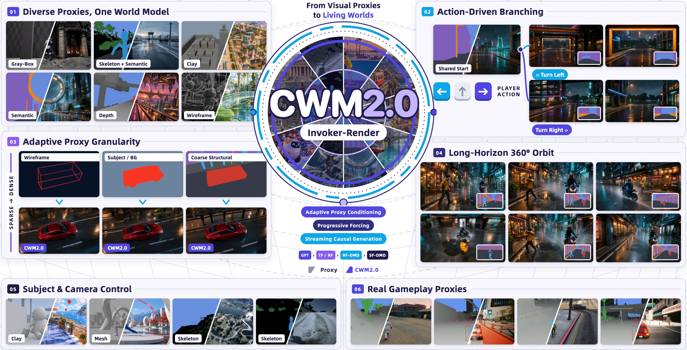

<p align="center">
  
</p>

<h1 align="center">Code World Model 2.0: Towards Infinite Controllable Video Generation</h1>

<p align="center">
  <b>Invoker-Render</b>: proxy-conditioned video rendering for offline creation and real-time streaming
</p>

<p align="center">
  Ruoyu Wang<sup>1,2,*</sup> · Jiahao Tian<sup>1,2,*</sup> · Hao Zhong<sup>2,3,*</sup> · Yanming Yang<sup>1,2,*</sup> · Lin Liu<sup>2,*,†</sup><br>
  Biao Gong<sup>2</sup> · Guoshan Lu<sup>2</sup> · Yiding Tian<sup>2</sup> · Chunhua Shen<sup>3,‡</sup> · Zhenzhong Lan<sup>1,2,‡</sup> · Chi Zhang<sup>1,‡</sup>
</p>

<p align="center">
  <sup>1</sup>Westlake University &nbsp; <sup>2</sup>AGI Research Center, Inclusion AI &nbsp; <sup>3</sup>Zhejiang University<br>
  <sub><sup>*</sup>Equal contribution &nbsp; <sup>†</sup>Project leader &nbsp; <sup>‡</sup>Corresponding author</sub>
</p>

<!-- Placeholders: the Homepage, Tech Report, Hugging Face, and demo-video pages are not published yet. Replace each href below with the real URL when it goes live. -->
<p align="center">
  <a href="#release-status"></a>
  <a href="#release-status"></a>
  <a href="#release-status"></a>
  <br>
  <a href="#demo"></a>
  <a href="docs/INFERENCE.md"></a>
</p>

<p align="center">
  <a href="#highlights">Highlights</a> ·
  <a href="#demo">Demo</a> ·
  <a href="#quick-start">Quick Start</a> ·
  <a href="#documentation">Documentation</a> ·
  <a href="#citation">Citation</a> ·
  <a href="README.zh-CN.md">简体中文</a>
</p>

---

Code World Model 2.0 keeps the world state in an upstream engine and hands rendering to a video model. The two are connected by **visual proxies**: plain structural videos that fix the camera path, scene layout, and entity motion, and leave appearance to the renderer.

**Invoker-Render** is that renderer. It takes a structural proxy, one appearance reference image, and text. This repository is the inference codebase for its **causal four-step streaming model**, built on **MiniMax-H3**, **SGLang**, and **SGLang-Omni**. The method, training data, and full evaluation are in the technical report.

## Highlights

- **Unbounded streaming, no visual jumps.** Each chunk reads a fixed appearance anchor and a bounded window of recent history, so a session runs for as long as proxy frames arrive. The racing demo below is one continuous 30-minute generation.
- **Coarse or fine proxies, chosen at run time.** One model accepts semantic maps, sparse 3D boxes, subject masks, shaded geometry, and boxes with skeletons, at any level of detail.
- **Four steps per chunk.** The streaming model is trained with Progressive Forcing, a staged curriculum described in the report.
- **Ahead of recent streaming renderers.** On 140 held-out rollouts it ranks first on all four judged axes, with an overall Elo of 1343.2 against 1245.3 for SolarRenderer (Causal), 1051.9 for StreamRender-H3, and 359.6 for Streaming CWM.
- **Ready to serve.** A WebSocket session service on eight GPUs, a file client, and an interactive browser client.

## Demo

<!-- Demo video placeholder: when the 30-minute video is on Bilibili, wrap the image below in <a href="BILIBILI_URL">…</a>, replace the "coming soon" sentence in the caption with a link, and point the demo-video badge at the top of this page to the same URL. -->
<p align="center">
  
  <br>
  <em>Racing demo: one continuous 30-minute generation. Short preview clips are shown here; the full video link is coming soon.</em>
</p>

<p align="center">
  
  <br>
  <em>A live session: a gamepad drives a racing proxy (inset, lower left) and Invoker-Render renders the stream. Phone recording of the monitor.</em>
</p>

The preview clips were generated with a reference-guided quality policy that the default service does not enable. Playback FPS is not inference throughput.

## Release Status

- [x] Streaming inference runtime, session service, file client, and browser client
- [x] Deployment guide
- [ ] Model weights on Hugging Face
- [ ] Technical report
- [ ] Homepage
- [ ] Full 30-minute demo video
- [ ] Creation-model inference, training code, and data

Unchecked items have not been published, and the Homepage, Tech Report, Hugging Face, and demo-video badges above are placeholders until they are. Model weights and prepared bundles are not included in this repository.

## Quick Start

**Requirements:** Linux, Python 3.11 or 3.12, and NVIDIA CUDA. The default `production` profile uses eight GPUs on one node. There is no standalone lockfile; provision the environment with the [environment guide](docs/INFERENCE.md#environment), then check it from the repository root:

```bash
PY=/path/to/serving-env/bin/python
"$PY" invoker_render.py check-env
```

**1. Prepare a bundle.** This hashes and references the model assets without copying them. The output directory must not exist yet. See [Bundle preparation](docs/INFERENCE.md#prepare-a-bundle) for each file.

```bash
ARTIFACT=/assets/invoker-render/artifact.json
BUNDLE=/assets/invoker-render/bundle

"$PY" invoker_render.py prepare \
  --artifact "$ARTIFACT" \
  --cwm-silence /assets/invoker-render/silence.safetensors \
  --decoder-config /assets/causal-decoder/config.json \
  --decoder-weights /assets/causal-decoder/decoder.safetensors \
  --state-reservation-gib 48 --output "$BUNDLE"
```

**2. Start the streaming service.** It binds loopback and serves sessions at `/v1/session`.

```bash
"$PY" invoker_render.py serve --model-path "$BUNDLE" --port 18860
```

**3. Render a video from files.** Run this in a second terminal.

```bash
"$PY" invoker_render.py infer \
  --model-path "$BUNDLE" --artifact "$ARTIFACT" \
  --uri ws://127.0.0.1:18860/v1/session \
  --first-image /inputs/first.png \
  --proxy-video /inputs/proxy.mkv \
  --prompt-file /inputs/prompt.txt \
  --seed 42 --output-dir /outputs/invoker-render-001
```

The first image is 1344×768 RGB. The proxy video is 24 FPS with `17*N+5` frames, at least 39. The output directory must be new; a completed run writes `video.mp4` and `inference.json`.

**4. Open the browser client (optional).** It reuses the running service.

```bash
"$PY" invoker_render.py web-adapter \
  --model-path "$BUNDLE" --artifact "$ARTIFACT" \
  --native-uri ws://127.0.0.1:18860/v1/session --port 18861

"$PY" invoker_render.py web \
  --backend http://127.0.0.1:18861 --port 18862 --incremental-proxy
```

Open `http://127.0.0.1:18862/` and select a first image that matches the scene.

## Documentation

| Task | Guide |
| --- | --- |
| Configure dependencies and CUDA | [Environment](docs/INFERENCE.md#environment) |
| Prepare checkpoints and model assets | [Model contract](docs/INFERENCE.md#model-contract) · [Bundle preparation](docs/INFERENCE.md#prepare-a-bundle) |
| Choose execution and codec placement | [Deployment profiles](docs/INFERENCE.md#deployment-profiles) |
| Run the streaming API and file client | [Serving and file inference](docs/INFERENCE.md#serve-and-run-files) |
| Use the browser client | [Browser deployment](docs/INFERENCE.md#browser-client) · [Client guide](src/sglang/projects/minimax_h3/web/playable/README.md) |
| Check timing and completion records | [Output verification](docs/INFERENCE.md#timing-and-output-verification) |

```text
invoker_render.py                           Command line: prepare, serve, infer, web-adapter, web, check-env
docs/                                       Deployment documentation
src/sglang/python/sglang/multimodal_gen/    Native inference runtime
src/sglang/projects/minimax_h3/             Model adapters, tools, configs, browser client, vendored frameworks
```

## Citation

The technical report is not public yet. Until it is, please cite:

```bibtex
@techreport{wang2026cwm2,
  title       = {Code World Model 2.0: Towards Infinite Controllable Video Generation},
  author      = {Wang, Ruoyu and Tian, Jiahao and Zhong, Hao and Yang, Yanming and Liu, Lin and Gong, Biao and Lu, Guoshan and Tian, Yiding and Shen, Chunhua and Lan, Zhenzhong and Zhang, Chi},
  institution = {Westlake University; AGI Research Center, Inclusion AI; Zhejiang University},
  year        = {2026}
}
```

## Acknowledgements and License

Invoker-Render builds on MiniMax-H3, [SGLang](src/sglang/), [SGLang-Omni](src/sglang/projects/minimax_h3/frameworks/sglang-omni/), and the other vendored open-source components listed in [Third-party notices](THIRD_PARTY_NOTICES.md). We thank their authors.

The code written for this repository is released under the [Apache License 2.0](LICENSE). Vendored components keep their own licenses, which include Apache-2.0 and CC BY-NC 4.0 (non-commercial) terms; the license file inside each component directory governs that component. Model weights and other separately distributed assets have their own terms. Read the [legal notice](LEGAL.md) before use or redistribution.
