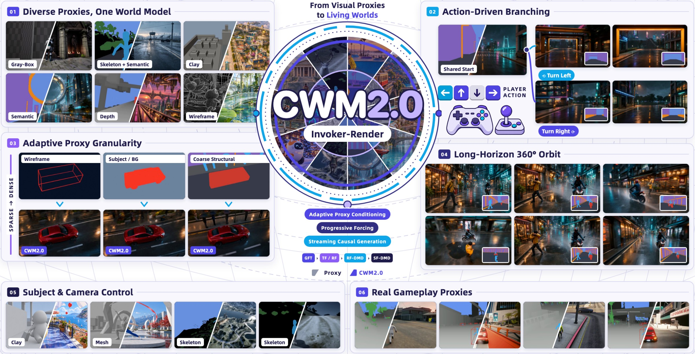
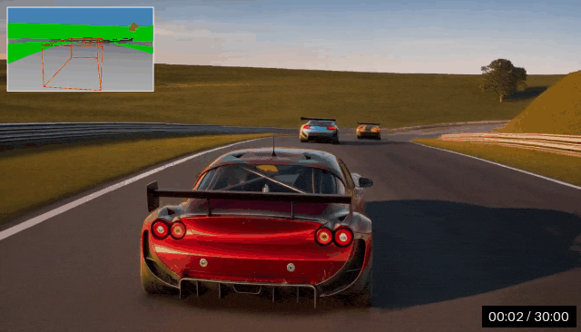
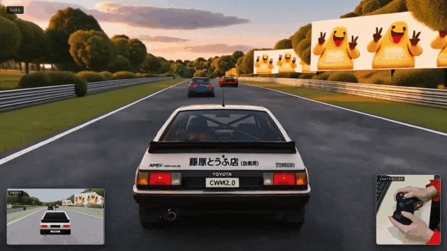
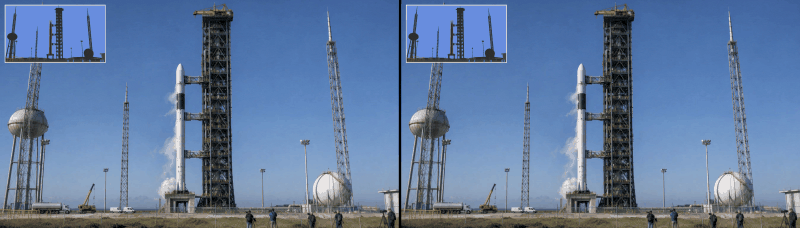
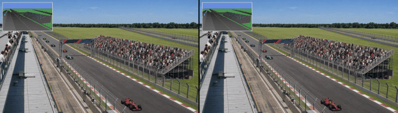

<p align="center">
  
</p>

<h1 align="center">Code World Model 2.0: Towards Infinite Controllable Video Generation</h1>

<p align="center">
  <b>Invoker-Render</b>：以 Proxy 为条件的视频渲染模型，同时支持离线创作与实时流式生成
</p>

<p align="center">
  Ruoyu Wang<sup>1,2,*</sup> · Hao Zhong<sup>2,3,*</sup> · Yanming Yang<sup>1,2,*</sup> · Jiahao Tian<sup>1,2,*</sup> · Lin Liu<sup>2,*,†</sup><br>
  Biao Gong<sup>2</sup> · Guoshan Lu<sup>2</sup> · Yiding Tian<sup>2</sup> · Chunhua Shen<sup>3,‡</sup> · Zhenzhong Lan<sup>1,2,‡</sup> · Chi Zhang<sup>1,‡</sup>
</p>

<p align="center">
  <sup>1</sup>西湖大学 &nbsp; <sup>2</sup>AGI Research Center, Inclusion AI &nbsp; <sup>3</sup>浙江大学<br>
  <sub><sup>*</sup>共同一作 &nbsp; <sup>†</sup>项目负责人 &nbsp; <sup>‡</sup>通讯作者</sub>
</p>

<!-- 占位：主页、技术报告和 Hugging Face 页面尚未发布。上线后把下面对应的 href 换成真实地址。 -->
<p align="center">
  <a href="#发布状态"></a>
  <a href="#发布状态"></a>
  <a href="#发布状态"></a>
  <a href="docs/INFERENCE.md"></a>
</p>

<p align="center">
  <a href="#亮点">亮点</a> ·
  <a href="#演示">演示</a> ·
  <a href="#快速开始">快速开始</a> ·
  <a href="#文档">文档</a> ·
  <a href="#引用">引用</a> ·
  <a href="README.md">English</a>
</p>

---

Code World Model 2.0 把世界状态交给上游引擎维护，把渲染交给视频模型。连接两者的是**视觉 Proxy**：一段只含结构的视频，规定相机路径、场景布局和物体运动，外观留给渲染器。

**Invoker-Render** 就是这个渲染器，输入是结构 Proxy、一张外观参考图和文本。本仓库是其中**因果四步流式模型**的推理代码，基于 **MiniMax-H3**、**SGLang** 和 **SGLang-Omni**。方法、训练数据和完整评测见技术报告。

## 亮点

- **无限时长流式生成，画面不跳变。** 每一块只读取固定的外观锚点和有界的近期历史窗口，Proxy 帧输入多久就能生成多久。下面的赛车演示是一段连续生成的 30 分钟视频。
- **粗细 Proxy 都能用，运行时再选。** 同一个模型接受语义图、稀疏 3D 框、主体掩码、带明暗的几何体，以及框加骨架，粒度不限。
- **每块四步。** 流式模型用 Progressive Forcing 训练，这套分阶段的训练方法见技术报告。
- **领先近期的流式渲染方法。** 在 140 条留出序列上，四个评测维度都排第一。整体 Elo 为 1343.2，SolarRenderer (Causal) 为 1245.3，StreamRender-H3 为 1051.9，Streaming CWM 为 359.6。
- **可直接部署。** 提供跑在八张 GPU 上的 WebSocket 会话服务、文件客户端和交互式浏览器客户端。

## 演示

<!-- 演示视频占位：完整视频上线后，用 <a href="视频地址">…</a> 包住下面的图片，并把第一条说明里的“链接即将发布”换成链接。 -->
每段视频都把输入的 Proxy 以小窗叠在画面上：小窗决定镜头和物体怎么动，材质和光影由模型生成。

**长时间流式生成**

<p align="center">
  
  <br>
  <em>由粗粒度赛车 Proxy（左上角小窗）驱动、一镜到底连续生成的 30 分钟视频，中间没有切镜或重置。这里是六段各两秒的片段，时间戳标出它在整段中的位置。完整视频链接即将发布。</em>
</p>

**交互式驾驶**

<p align="center">
  
  <br>
  <em>手柄操控的一次会话：手柄（右下角小窗）控制低模 Proxy（左下角小窗）转向，渲染出的赛车同步转向。白车、前方两辆车和黄昏赛道全程保持一致。</em>
</p>

**相机控制**

同一个场景、同一张首帧、同一段事件，只换相机路线。左边是路线 A，右边是路线 B，各自带对应的 Proxy 小窗。

<p align="center">
  
  <br>
  <em>海岸隧道。A：无人机贴在车后一起穿过隧道，出洞后拉高。B：车进隧道时镜头升起越过山头，在出口上方等车钻出来再跟上。</em>
</p>

<p align="center">
  
  <br>
  <em>火箭发射。A：地面固定机位，仰头跟拍并逐渐推近。B：无人机从低空靠近发射塔，随火箭一起爬升，最后越过塔顶看向海岸。</em>
</p>

<p align="center">
  
  <br>
  <em>发卡弯超车。A：赛控楼顶的转播机位摇镜变焦，跟拍两车并排入弯。B：FPV 穿越机从楼顶俯冲到赛道，贴在超车赛车后上方全程跟随。</em>
</p>

预览是降采样后的片段，以 6 FPS 播放，源视频信息见 [`assets/demo/metadata.json`](assets/demo/metadata.json)。播放帧率不是模型生成速度。30 分钟赛车演示使用参考引导质量策略生成，默认服务不启用该策略。

## 发布状态

- [x] 流式推理运行时、会话服务、文件客户端和浏览器客户端
- [x] 部署指南
- [ ] Hugging Face 模型权重
- [ ] 技术报告
- [ ] 主页
- [ ] 完整的 30 分钟演示视频
- [ ] 创作模型推理、训练代码与数据

未勾选的条目尚未发布，上方的 Homepage、Tech Report 和 Hugging Face 徽章在发布前都是占位。本仓库不包含模型权重和准备好的 bundle。

## 快速开始

**环境要求：** Linux、Python 3.11 或 3.12、NVIDIA CUDA。默认的 `production` 配置使用单机八张 GPU。项目没有独立的 lockfile，请按[环境指南](docs/INFERENCE.md#environment)准备环境，然后在仓库根目录检查：

```bash
PY=/path/to/serving-env/bin/python
"$PY" invoker_render.py check-env
```

**1. 准备 bundle。** 这一步只对模型资产做哈希和引用，不复制文件。输出目录必须尚不存在。各文件的用途见 [bundle 准备说明](docs/INFERENCE.md#prepare-a-bundle)。

```bash
ARTIFACT=/assets/invoker-render/artifact.json
BUNDLE=/assets/invoker-render/bundle

"$PY" invoker_render.py prepare \
  --artifact "$ARTIFACT" \
  --cwm-silence /assets/invoker-render/silence.safetensors \
  --decoder-config /assets/causal-decoder/config.json \
  --decoder-weights /assets/causal-decoder/decoder.safetensors \
  --state-reservation-gib 48 --output "$BUNDLE"
```

**2. 启动流式服务。** 服务监听本机回环地址，会话入口为 `/v1/session`。

```bash
"$PY" invoker_render.py serve --model-path "$BUNDLE" --port 18860
```

**3. 用文件渲染视频。** 在第二个终端运行。

```bash
"$PY" invoker_render.py infer \
  --model-path "$BUNDLE" --artifact "$ARTIFACT" \
  --uri ws://127.0.0.1:18860/v1/session \
  --first-image /inputs/first.png \
  --proxy-video /inputs/proxy.mkv \
  --prompt-file /inputs/prompt.txt \
  --seed 42 --output-dir /outputs/invoker-render-001
```

首图为 1344×768 的 RGB 图像。Proxy 视频为 24 FPS，帧数为 `17*N+5`，不少于 39 帧。输出目录必须是新的，运行成功后写出 `video.mp4` 和 `inference.json`。

**4. 打开浏览器客户端（可选）。** 它复用已经启动的服务。

```bash
"$PY" invoker_render.py web-adapter \
  --model-path "$BUNDLE" --artifact "$ARTIFACT" \
  --native-uri ws://127.0.0.1:18860/v1/session --port 18861

"$PY" invoker_render.py web \
  --backend http://127.0.0.1:18861 --port 18862 --incremental-proxy
```

打开 `http://127.0.0.1:18862/`，选一张与场景匹配的首图。

## 文档

| 任务 | 文档 |
| --- | --- |
| 配置依赖与 CUDA | [环境要求](docs/INFERENCE.md#environment) |
| 准备权重与模型资产 | [模型契约](docs/INFERENCE.md#model-contract) · [Bundle 准备](docs/INFERENCE.md#prepare-a-bundle) |
| 选择执行与 codec 放置方式 | [部署配置](docs/INFERENCE.md#deployment-profiles) |
| 使用流式 API 与文件客户端 | [服务与文件推理](docs/INFERENCE.md#serve-and-run-files) |
| 使用浏览器客户端 | [浏览器部署](docs/INFERENCE.md#browser-client) · [客户端说明](src/sglang/projects/minimax_h3/web/playable/README.md) |
| 检查耗时与完成记录 | [输出检查](docs/INFERENCE.md#timing-and-output-verification) |

```text
invoker_render.py                           命令行：prepare、serve、infer、web-adapter、web、check-env
docs/                                       部署文档
src/sglang/python/sglang/multimodal_gen/    原生推理运行时
src/sglang/projects/minimax_h3/             模型适配、工具、配置、浏览器客户端和随仓库提供的框架
```

## 引用

技术报告尚未公开。在此之前请这样引用：

```bibtex
@techreport{wang2026cwm2,
  title       = {Code World Model 2.0: Towards Infinite Controllable Video Generation},
  author      = {Wang, Ruoyu and Zhong, Hao and Yang, Yanming and Tian, Jiahao and Liu, Lin and Gong, Biao and Lu, Guoshan and Tian, Yiding and Shen, Chunhua and Lan, Zhenzhong and Zhang, Chi},
  institution = {Westlake University; AGI Research Center, Inclusion AI; Zhejiang University},
  year        = {2026}
}
```

## 致谢与许可

Invoker-Render 基于 MiniMax-H3、[SGLang](src/sglang/)、[SGLang-Omni](src/sglang/projects/minimax_h3/frameworks/sglang-omni/)，以及[第三方声明](THIRD_PARTY_NOTICES.md)中列出的其他开源组件。感谢这些项目的作者。

本仓库自有代码以 [Apache License 2.0](LICENSE) 发布。随仓库提供的第三方组件保留各自的许可，其中包括 Apache-2.0 和 CC BY-NC 4.0（非商业）条款，以各组件目录内的许可文件为准。模型权重和其他单独分发的资产另有条款。使用或再分发前请阅读[法律说明](LEGAL.md)。
